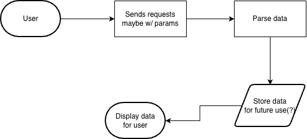

# news_information_final
Shows the user some news articles including its title, description, and link if the user wishes to pursue more.
# News Information

Displays a couple news articles to the user.

## The Problem

There's a lot of things going on around the world and sometimes it's hard to keep up. This program just takes some filters and displays a couple news articles from various sources.

## How It Works

The can input some filters which goes through the program and the program searches for news that follow the filters and displays it back to the user.

## Tech Stack

- **Language:** Python
- **Libraries:** JSON, Requests, PySide6
- **External tools:** Mediastack API via APILayer

## Setup

## Usage

## Roadmap

- [ ] GUI Interface
- [ ] Supporting filters from the user

## Author

Yin You, https://github.com/YinYCollege.
